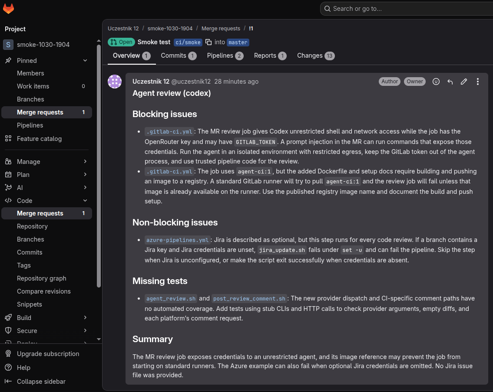

# Przykład: review Codex w merge requeście GitLab (30.10.2026)

Komentarz opublikowany przez job `codex-review` z [`.gitlab-ci.yml` dla Cargo Tracker](../../gitlab-cargo-tracker/.gitlab-ci.yml) w testowym MR na GitLab szkoleniowym. Obraz `agent-ci:1` z Codex CLI 0.165.0, model `openai/gpt-6-luna` przez OpenRouter, sandbox `danger-full-access` w kontenerze joba. Treść poniżej jest kopią komentarza bez zmian.

---

### Agent review (codex)

## Blocking issues

- `.gitlab-ci.yml` (.gitlab-ci.yml:42): The MR review job gives Codex unrestricted shell and network access while the job has the OpenRouter key and may have `GITLAB_TOKEN`. A prompt injection in the MR can run commands that expose those credentials. Run the agent in an isolated environment with restricted egress, keep the GitLab token out of the agent process, and use trusted pipeline code for the review.
- `.gitlab-ci.yml` (.gitlab-ci.yml:31): The job uses `agent-ci:1`, but the added Dockerfile and setup docs require building and pushing an image to a registry. A standard GitLab runner will try to pull `agent-ci:1` and the review job will fail unless that image is already available on the runner. Use the published registry image name and document the build and push setup.

## Non-blocking issues

- `azure-pipelines.yml` (ci/agent-review/pipelines/azure-pipelines.yml:54): Jira is described as optional, but this step runs for every code review. If a branch contains a Jira key and Jira credentials are unset, `jira_update.sh` fails under `set -u` and can fail the pipeline. Skip the step when Jira is unconfigured, or make the script exit successfully when credentials are absent.

## Missing tests

- `agent_review.sh` (ci/agent-review/agent_review.sh:64) and `post_review_comment.sh` (ci/agent-review/post_review_comment.sh:17): The new provider dispatch and CI-specific comment paths have no automated coverage. Add tests using stub CLIs and HTTP calls to check provider arguments, empty diffs, and each platform’s comment request.

## Summary

The MR review job exposes credentials to an unrestricted agent, and its image reference may prevent the job from starting on standard runners. The Azure example can also fail when optional Jira credentials are omitted. No Jira issue file was provided.
