# GitLab Self-Managed w ChatGPT i Codex

Połącz własną instancję GitLaba z ChatGPT Business lub inną zarządzaną przestrzenią roboczą. Zacznij od projektu testowego, do którego masz dostęp w GitLabie. Potrzebujesz uprawnień administratora lub właściciela przestrzeni ChatGPT oraz uprawnień do rejestracji aplikacji OAuth w GitLabie.

W DevPowers potwierdziliśmy odczyt projektów w zwykłym czacie ChatGPT. Status podłączenia repozytorium do środowiska Codex Cloud opisuje krok 5.

- [Instrukcja OpenAI konfiguracji szablonu GitLab Self-Managed](https://help.openai.com/pl-pl/articles/20001487-setting-up-the-gitlab-self-managed-app-template-for-chatgpt-and-codex)
- [Konfiguracja GitLaba i środowisk projektu w Codex Cloud](https://learn.chatgpt.com/docs/third-party/gitlab)

## 1. Otwórz szablon GitLab Self-Managed

W [konsoli administratora ChatGPT](https://admin.openai.com/) wybierz właściwą przestrzeń roboczą (1), przejdź do **Wtyczek** (2) i w zakładce **Publiczny** wyszukaj `GitLab` (3). Otwórz **GitLab (Beta)** (4).

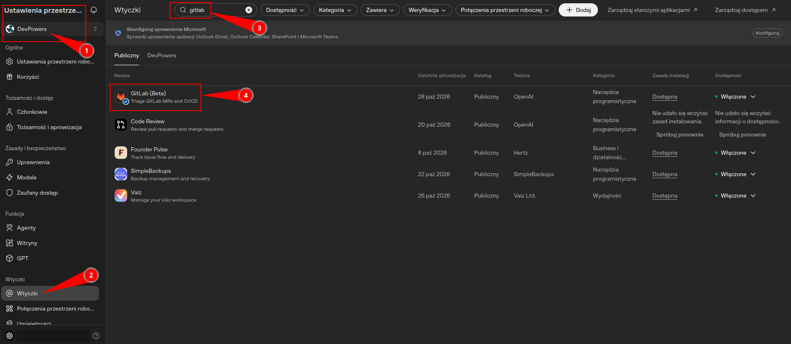

Na karcie wtyczki w sekcji **Aplikacje** kliknij **GitLab Self-Managed**, oznaczony jako **Szablon**. Jeśli Twoja konsola odsyła do katalogu aplikacji, wejdź w **Wtyczki → Zarządzaj starszymi aplikacjami → Katalog** i wybierz ten sam szablon. [Instrukcja OpenAI](https://help.openai.com/pl-pl/articles/20001487-setting-up-the-gitlab-self-managed-app-template-for-chatgpt-and-codex)

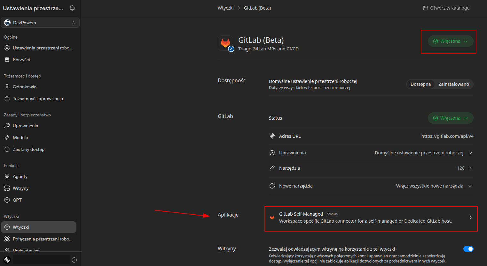

## 2. Skopiuj adres przekierowania z ChatGPT

W oknie **Nowa aplikacja GitLab Self-Managed** podaj nazwę, np. `GitLab firmowy`, oraz krótki opis, np. `Odczyt repozytoriów, merge requestów i pipeline'ów na firmowym GitLabie`. W sekcji **Instancja GitLab** wpisz samą nazwę hosta, np. `gitlab.example.com`, bez `https://`, portu i ścieżki.

Kliknij ikonę kopiowania obok pola **Adres URL przekierowania OAuth**. Użyj dokładnego adresu z własnego formularza. Zostaw kartę otwartą. Identyfikator i tajny klucz klienta uzupełnisz po utworzeniu aplikacji w GitLabie.

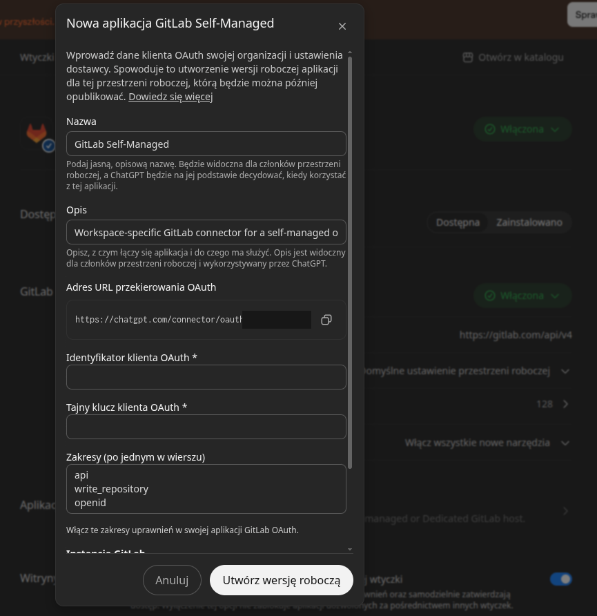

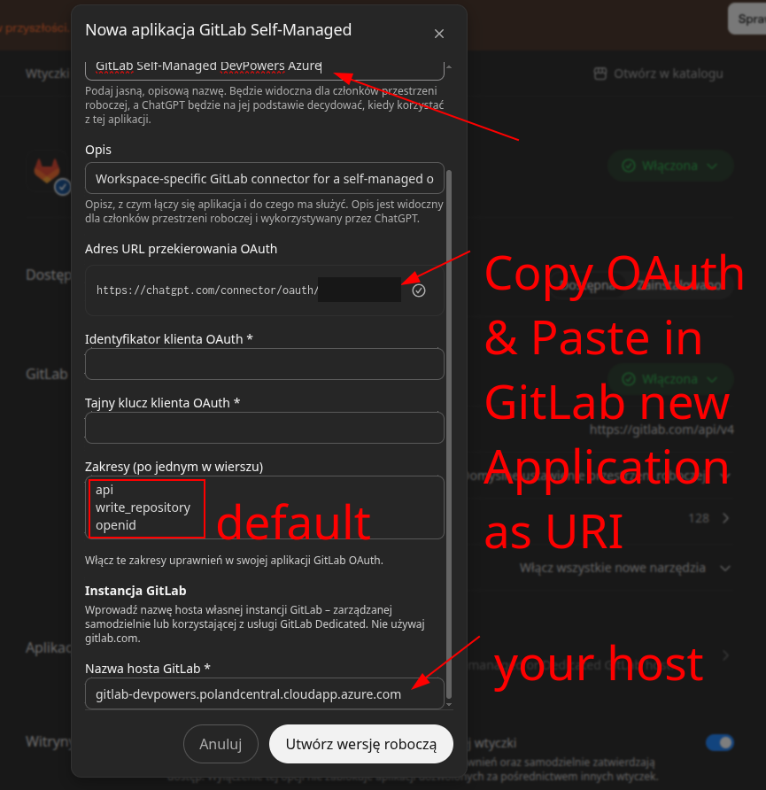

## 3. Utwórz aplikację OAuth w GitLabie

W osobnej karcie otwórz własnego GitLaba. Wybierz **Admin → Applications** dla aplikacji zarządzanej przez administratora instancji albo **Settings → Applications** w grupie, jeśli zarządzasz aplikacją jako właściciel grupy.

Kliknij **New application** i podaj nazwę, np. `ChatGPT i Codex`. W polu **Redirect URI** wklej adres skopiowany z ChatGPT. Pozostaw włączone **Confidential**. W konfiguracji pokazanej poniżej **Trusted** jest wyłączone, dzięki czemu GitLab wyświetla użytkownikowi ekran zgody. **Device authorization grant** pozostaje wyłączone, ponieważ połączenie używa przekierowania w przeglądarce. [Dokumentacja OAuth GitLaba](https://docs.gitlab.com/integration/oauth_provider/)

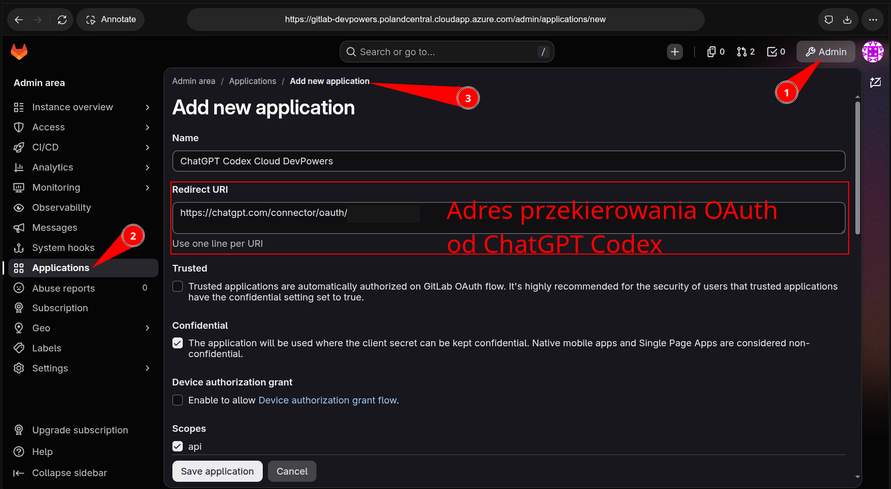

Zaznacz tylko trzy zakresy wymagane przez szablon: `api`, `write_repository` i `openid`. Przewiń listę zakresów, żeby znaleźć `openid`. Kliknij **Save application**.

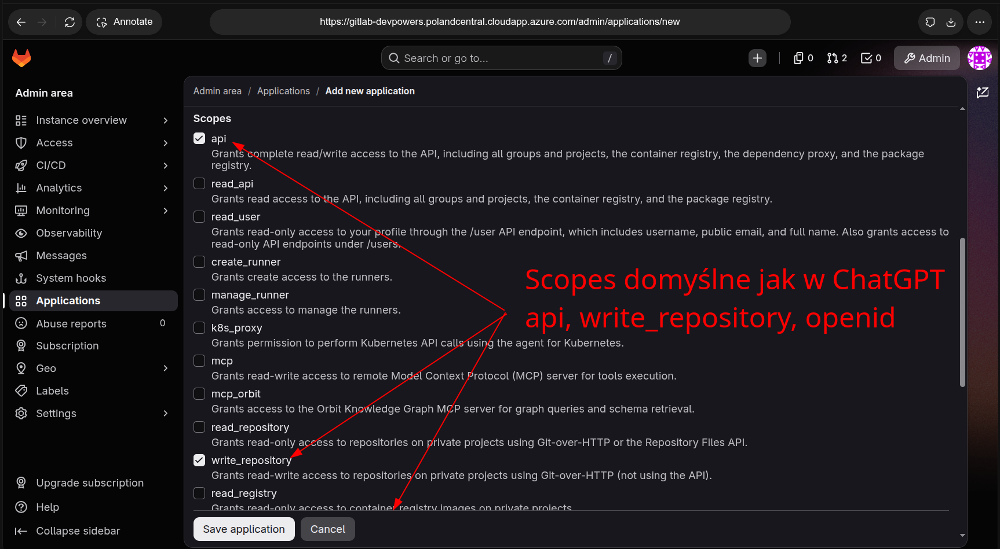

GitLab wyświetli potwierdzenie zapisu oraz **Application ID** i **Secret**. Skopiuj każdą wartość ikoną obok jej pola. Na tym ekranie sekret jest dostępny do skopiowania po raz pierwszy. Zachowaj kartę do chwili, gdy wkleisz obie wartości w ChatGPT.

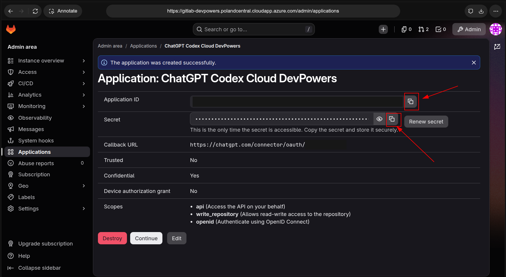

## 4. Opublikuj i połącz aplikację

Wróć do formularza ChatGPT. Wklej **Application ID** w pole **Identyfikator klienta OAuth**, a **Secret** w pole **Tajny klucz klienta OAuth**. Wprowadź sekret bezpośrednio w formularzu i kliknij **Utwórz wersję roboczą**.

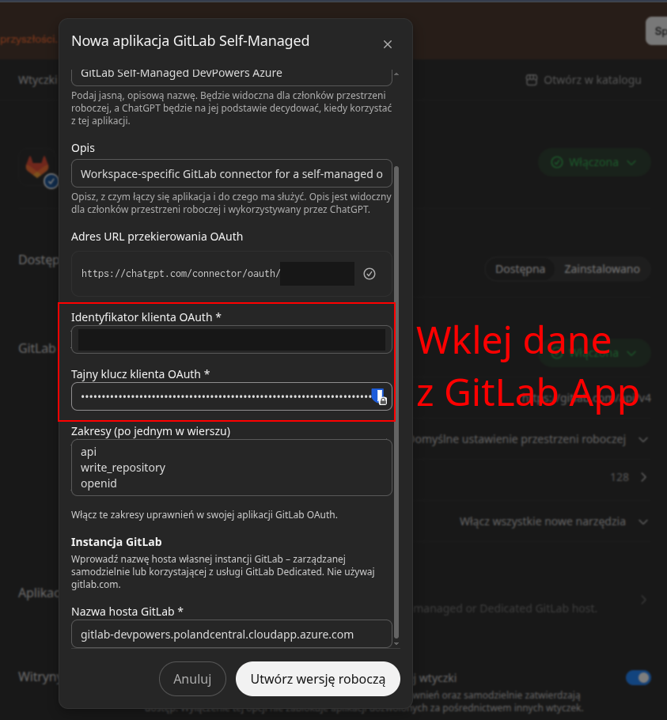

Jeśli ChatGPT zgłosi błąd tworzenia aplikacji, otwórz kartę wtyczki **GitLab (Beta)** w osobnej karcie przeglądarki. W sekcji **Aplikacje** sprawdź, czy pojawiła się wersja robocza pod wybraną nazwą. Jeśli istnieje, otwórz ją i kontynuuj. Przed ponowieniem sprawdź zgodność hosta, adresu przekierowania i danych klienta OAuth. [Rozwiązywanie problemów z szablonem](https://help.openai.com/articles/20001487#troubleshooting-gitlab-self-managed-app-setup)

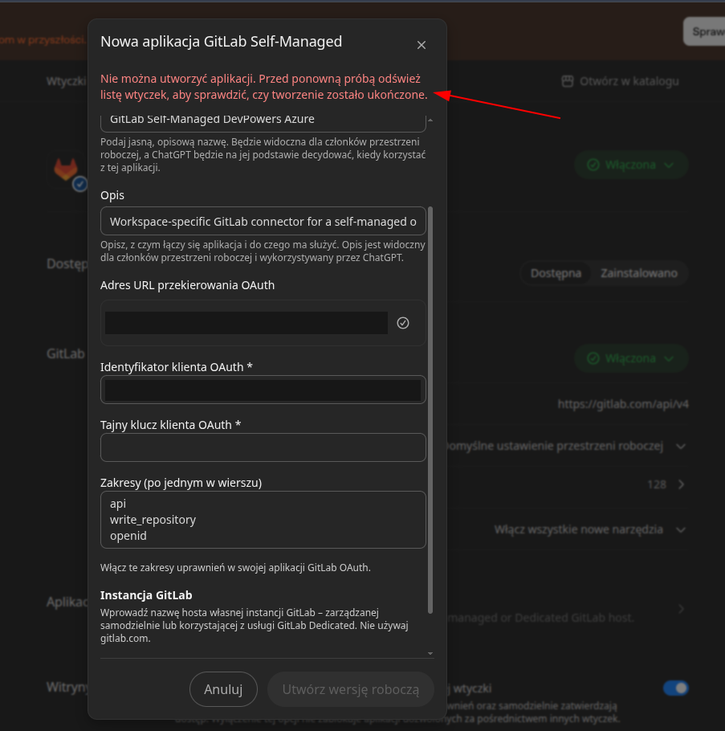

Otwórz wersję roboczą oznaczoną jako **Private**. Sprawdź listę narzędzi odczytu (**Read tools**) i zapisu (**Write tools**), a następnie kliknij **Publish**, żeby otworzyć okno publikacji.

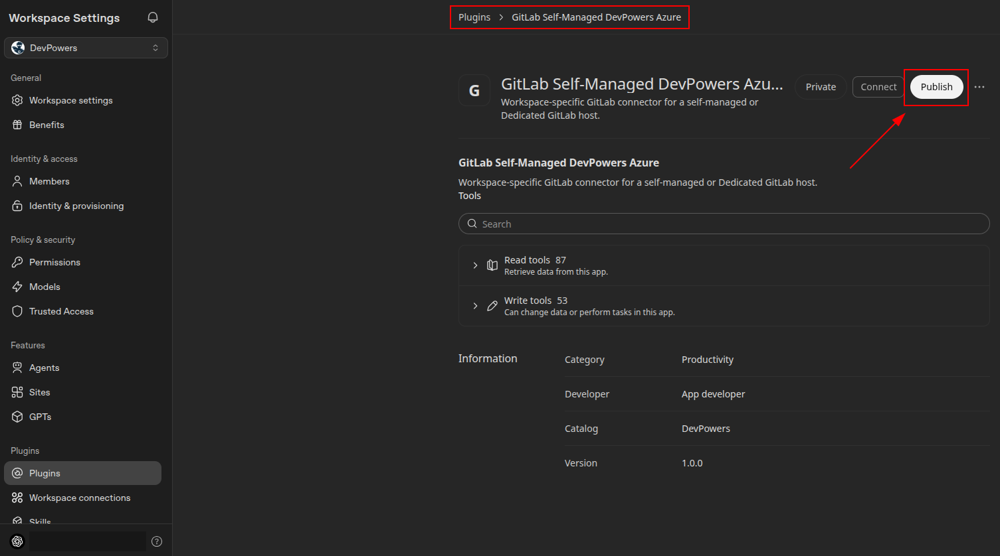

W oknie publikacji użyj **Configure tools**, aby wybrać dostępne narzędzia, oraz **Configure approvals**, aby ustawić, kiedy ChatGPT ma pytać o zgodę. Na szkoleniu możesz zezwolić na odczyt i wymagać zgody przed zapisem. Kliknij **Publish** w tym oknie, żeby udostępnić aplikację w przestrzeni roboczej.

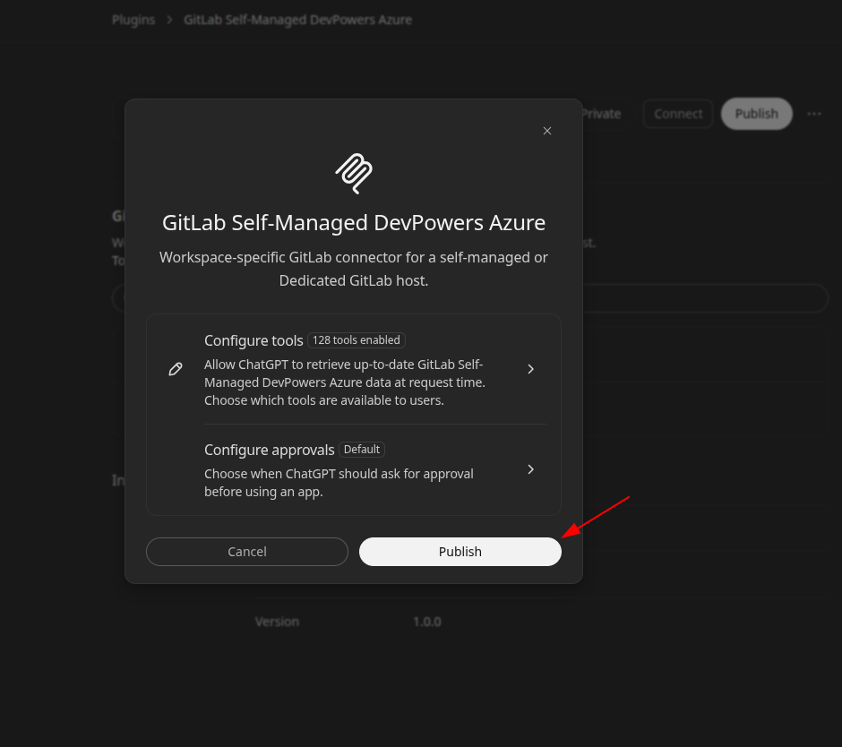

Po publikacji sprawdź, czy aplikacja ma status **Enabled**, a pole **URL** wskazuje na API Twojego hosta GitLab. W sekcji **Availability** opcja **Available** pozwala członkom zainstalować wtyczkę samodzielnie. **Installed** instaluje ją domyślnie w przestrzeni roboczej. Ustawienie **Sites** dotyczy dostępu odwiedzających witryny. [Zarządzanie dostępem do wtyczek](https://help.openai.com/en/articles/11509118-admin-controls-security-and-compliance-for-plugins-and-apps)

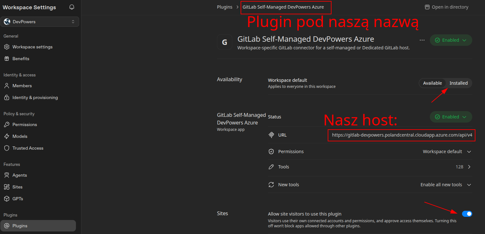

Na swoim koncie, w tej samej przestrzeni roboczej, otwórz **Settings → Plugins** i wybierz wtyczkę GitLab Self-Managed pod nazwą nadaną przez administratora. Przy ustawieniu **Installed** znajdziesz ją na liście zainstalowanych wtyczek. Przy ustawieniu **Available** możesz ją najpierw zainstalować przez **Browse directory**.

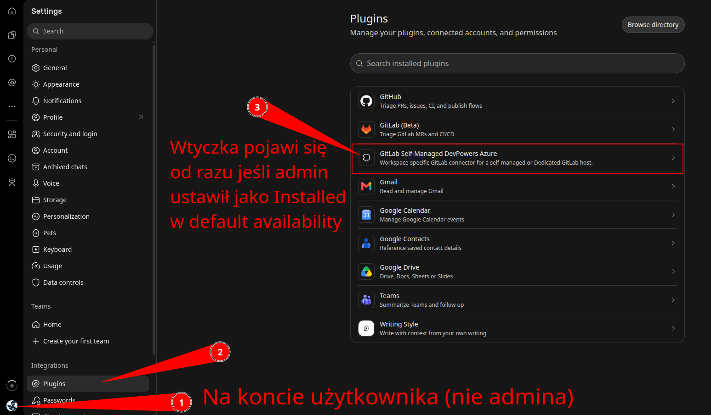

Na karcie wtyczki wybierz **Connect**. Etykieta **Installed by your admin** potwierdza instalację wtyczki. Każdy uczestnik łączy własne konto.

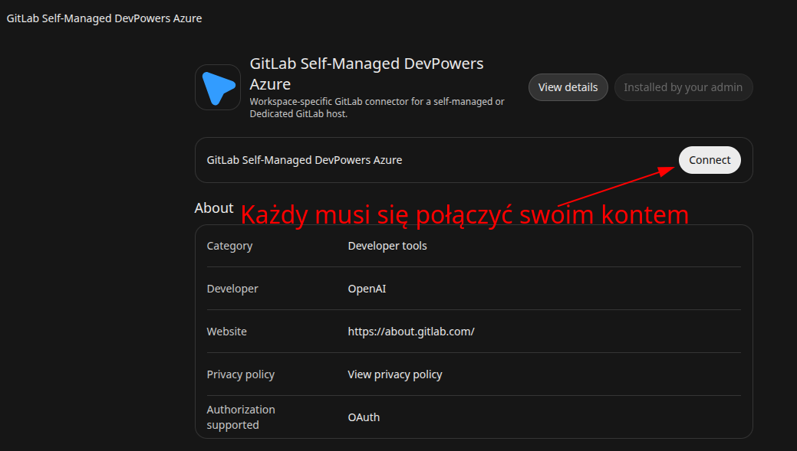

W oknie połączenia kliknij **Continue to GitLab Self-Managed DevPowers Azure**.

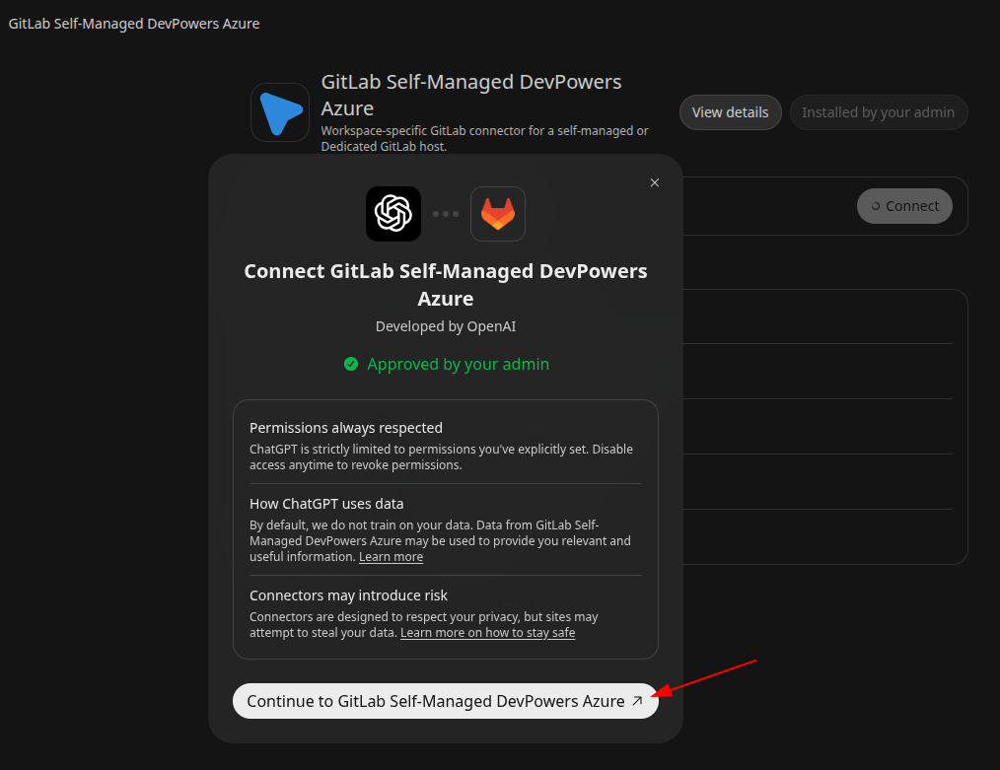

Po przekierowaniu sprawdź adres instancji. Jeśli GitLab pokazuje formularz logowania, zaloguj się na swoje konto szkoleniowe na tym hoście.

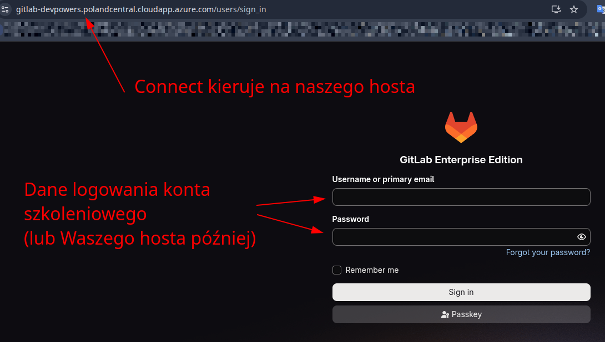

Na ekranie zgody sprawdź nazwę aplikacji, aktywne konto i zakres dostępu. Do ćwiczenia użyj konta szkoleniowego bez uprawnień administratora. Jeśli GitLab wyświetla ostrzeżenie o uprawnieniach administratora, wybierz **Cancel** i przełącz konto przed ponowieniem połączenia. Na właściwym koncie kliknij **Authorize**.

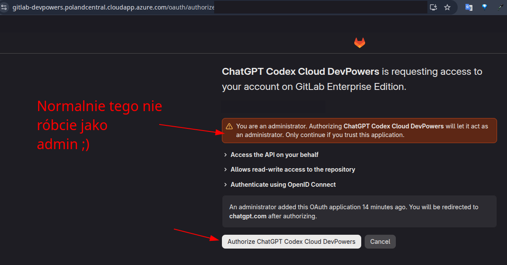

Po powrocie do ChatGPT sprawdź, czy Twoje konto jest widoczne w sekcji **Connected accounts**. To potwierdza, że ChatGPT zapisał połączenie OAuth.

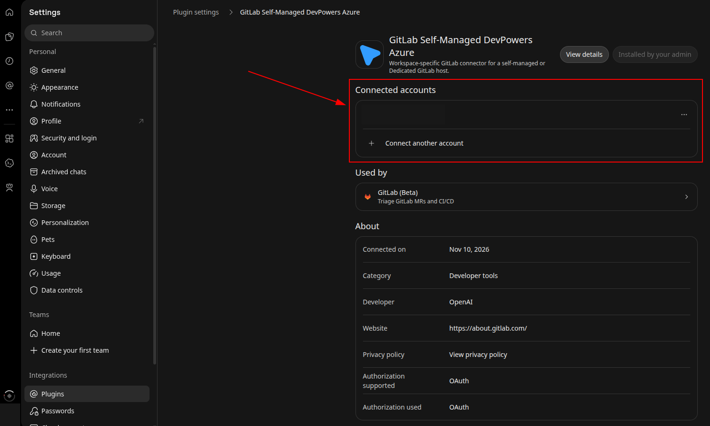

Żeby sprawdzić odczyt danych, otwórz nowy czat w ChatGPT. Wpisz `@git` i wybierz wtyczkę **GitLab Self-Managed DevPowers Azure**. Zapytaj, jakie projekty widzi na tej instancji, i sprawdź, czy odpowiedź zawiera znany Ci projekt szkoleniowy. Możesz też podać adres testowego merge requesta i poprosić o jego tytuł.

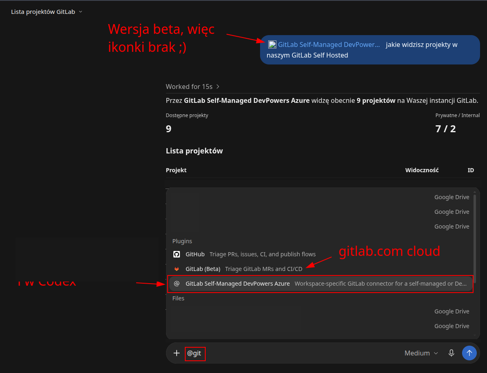

## 5. Sprawdź środowisko projektu

Wróć do kreatora **Codex Cloud Environment** i sprawdź, czy w selektorze repozytoriów pojawia się projekt z Twojej instancji. Jeśli jest widoczny, wybierz go, skonfiguruj polecenie testowe projektu i uruchom zadanie, które odczyta plik z klonu oraz wykona test.

W DevPowers sprawdziliśmy kreator **Create environment** i edycję istniejącego środowiska. Selektor połączeń pokazuje ogólną pozycję **GitLab**, także w **Manage connections**. Obie ścieżki przekierowały do GitLab.com. Po autoryzacji selektor pokazał repozytoria z GitLab.com. Repozytoria ze szkoleniowego hosta nie pojawiły się w tym widoku.

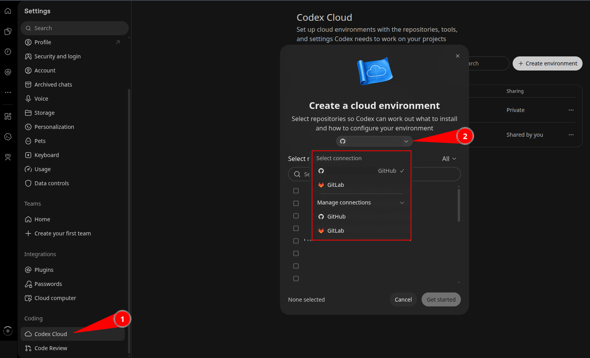

OpenAI opisuje osobną ścieżkę dla GitLab Self-Managed w **Codex Cloud → Settings → Connectors**, gdzie administrator wybiera aplikację dla własnego hosta i może skonfigurować konto serwisowe do obsługi aktywności z GitLaba. Tę ścieżkę trzeba jeszcze sprawdzić w DevPowers. Odczyt przez wtyczkę w czacie i wykonanie zadania na klonie w środowisku to dwa osobne testy. [Konfiguracja połączenia i konta serwisowego](https://learn.chatgpt.com/docs/third-party/gitlab#set-up-the-gitlab-connection-and-codex-review-identity)
